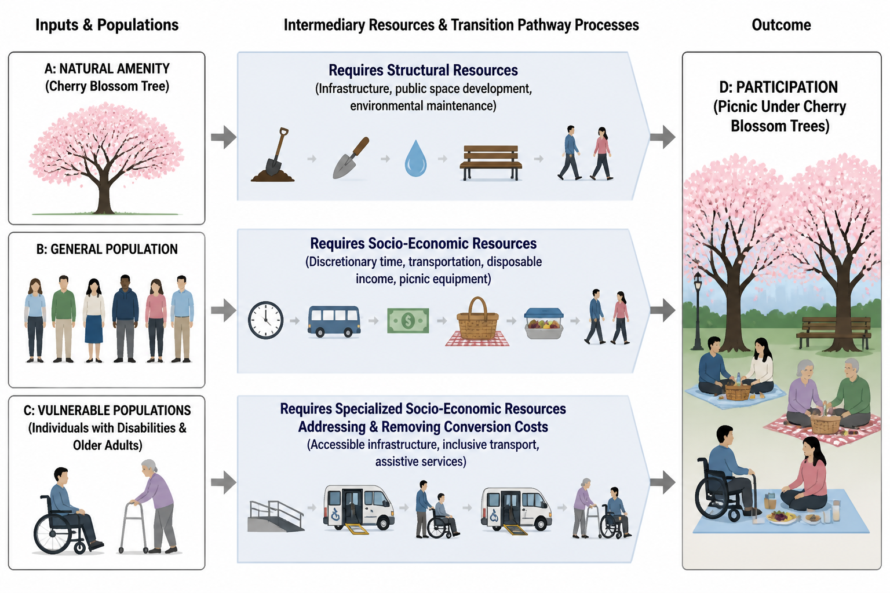

> I wrote this article to recognize October as ADHD and Neurodiversity Awareness Month, inspired by the recent conversations surrounding UK Channel 4’s documentary, [‘_The Great Myth of ADHD’_](https://youtu.be/Kg4Fq3VVuzs?si=H3LRh9RZQPir7Mvz).

---

**Appreciating Fleeting Blossoms**

Every spring in Japan, from the warm south to the cooler north, cherry trees open their blossoms, and millions of people gather beneath the falling sakura petals for a centuries-old custom called ['Hanami'](https://en.wikipedia.org/wiki/Hanami), or flower viewing. Parks fill with picnics and poetry, office parties and family reunions, all held in the brief window before the petals scatter.

The custom reaches back to around 812 CE in Kyoto. Farmers once read the timing of the bloom as a natural calendar, a sign that warmth had arrived and that the rice fields were ready to be ploughed. Before long, the imperial court began gathering to admire the blossoms as well, turning a seasonal signal into an art of living. To watch the cherry trees was to practice patience, to stay in rhythm with the land, and to appreciate life as it quietly unfolded.

The blossoms carry a deeper meaning, because they last only a week or so before they fall. The sakura became Japan's great symbol of impermanence, what the Japanese call ['mono no aware'](https://en.wikipedia.org/wiki/Mono_no_aware), the gentle tenderness of knowing that beautiful things do not stay forever. In this sense, 'Hanami' is a yearly rehearsal in cherishing life precisely because it is so fleeting.

Over the centuries, the tradition spread from high society to ordinary families until it became a shared cultural milestone. Today, whole communities wait for the bloom the way others wait for a holiday, and public broadcasters and newspapers follow its progress as a matter of national interest.

**The Science as a Welfare**

In time, that ancient ritual also became a science. In 1955, the Japan Meteorological Agency began monitoring 58 'ideal trees' across the country to mark the official opening of each season. Today, detailed forecasting models track winter 'chilling hours' and spring 'growing degree-days' to predict the blooms almost to the hour, drawing on satellite data and crowdsourced reports from mobile apps.

A whole network of support has grown up around the tradition. [Forecasting](https://sakura.weathermap.jp/en.php) apps, carefully managed parks, and local services all help people take part in the season. Just as importantly, many of these services are designed so that people with disabilities and the elderly can still make their way to the blossoms and enjoy the day.

Programs such as the ['Universal Tourism Concierge'](https://kyoto-universal.jp/en/concierge/template/index.html), ['Certified Travel Assistants'](https://japannews.yomiuri.co.jp/society/general-news/20240923-212754/), and 'Station Assistants', backed by several government agencies, train welfare workers who can be hired to accompany elderly or disabled travelers on outings, including ['Hanami' tours](https://www.japan-guide.com/e/e2011_where.html), making sure their medical and mobility needs are met along the way.

Many towns add their own community schemes, such as the well-loved [Fureai Kippu (Caring Relationship Tickets) ](https://patimes.org/providing-services-aging-population-increasing-costs/)system or local reward points like Jozurusan Pay. Through these, volunteers earn credits by helping elderly neighbors go for a walk, run errands, or visit a nearby park to see the cherry blossoms.

And yet the true heart of 'Hanami' is not the precision of a forecast, the glow of a mobile application, monetary and materials support. It is the moment a person steps outside and sits down with others beneath the blossoming tree, sharing the quiet appreciation, the laughter, and the reflection on how precious life is.

[“Even a sea bream loses its flavor when eaten alone.”](https://economictimes.indiatimes.com/news/international/us/japanese-proverb-of-the-day-even-a-sea-bream-loses-its-flavor-when-eaten-alone-a-timeless-lesson-on-friendship-connection-and-the-joy-of-sharing/articleshow/132220434.cms?from=mdr) – *an old Japanese saying*

**What Are Human?**

This blend of science and shared humanity made me reflect on what social and health policy is really for. It brought to mind [the Capability Approach](https://plato.stanford.edu/entries/capability-approach/), a framework in economics and philosophy developed by the Nobel laureate [Amartya Sen](https://en.wikipedia.org/wiki/Amartya_Sen) and the philosopher [Martha Nussbaum](https://en.wikipedia.org/wiki/Martha_Nussbaum). At its heart sits one deceptively simple question: what are people actually able to do and to be?

Instead of measuring success by the total amount of happiness or efficiency a society produces when it shares out public resources, the approach puts the individual first. The real question is not how much a society produces, but what each person is genuinely free to do and to become.

This matters most where resources are scarce. When efficiency and cost-effectiveness always come first, people can quietly be reduced to units of production and consumption, valued mainly for what they can spend. Policies then reward compliance over dignity, and those seen as 'non-productive' become invisible, noticed only when they can be made useful again. That is the logic of [ableism](https://en.wikipedia.org/wiki/Ableism), not of genuine well-being. Longer lives, better healthcare, and new technologies are all worth celebrating, but only insofar as they widen the real opportunities, the capabilities, of a real human life (Sen, 1999; Davies, 2015; Fine, 2002; Marcuse, 1955).

**Resources as Means into Real Freedom**

Seen through this lens, the tools of 'Hanami' fall into place. A bloom-forecasting app, a monetary subsidy, a reserved and accessible space, the Universal Tourism program, the government-backed assistants: all of these are what the approach calls a *vector of socioeconomic commodities*. They are packaged thoughtfully as an instruments of *'equity'*. In principle, everyone has an *'equal opportunity'* to attend 'Hanami', since no one is stopped from going. But not every one are capable to do so. The equity comes in to fulfil the capabilities.

For example, an elderly or disabled person, or [persons with neurodiversity](https://neurodiversity.directory/neurodiversity-statistics/), may still find it hard to take part or participate due to different in physical, mental, sensory-motor processing . This is where the specially designed subsidies and assistance come in. They are a form of 'equity', offered to particular people in particular set so that they too can join in, physically, psychologically, socially, financially, with comfortably, if sitting beneath the blossoms is something they truly value. And if it is not what they value, choosing to stay home is perfectly fine.

What actually turns a resource into a *'real opportunity'*, or capability, are three kinds of *conversion factors*: *personal*, such as a person's body and mind; *social*, such as laws, norms, prejudices, and strict preferential on expression; and *environmental ones*, such as how the physical world, the space, the lights, the sound is designed and operated. The same subsidy, the same app, and the same classroom, rolled out for the majority, can make impacts on lives very different depending on how well these factors line up, most might be better-off, and the worst-off will be sacrificed for the rule of 'social utility maximization'. 

Together, these conversion factors build what is called a *person's capability set*. Martha Nussbaum took the idea one step further, proposing a core list of [ten central capabilities](https://raggeduniversity.co.uk/2022/09/28/martha-nussbaum-public-services/) that any society committed to human dignity should protect for everyone.

Her list runs from the most basic to the most social: (1) life; (2) bodily health; (3) bodily integrity and safety from harm; (4) the free use of our senses, imagination, and thought; (5) the full range of human emotions; (6) practical reason, the freedom to reflect and plan one's own life; (7) affiliation, living among others as an equal and free from humiliation; (8) a caring relationship with other species and the natural world; (9) play, rest, and laughter; and (10) control over one's environment, from a real voice in political life to fair terms at work.

$$\underbrace{\text{Commodities + Conversion Factors}}_{\text{Inputs \& Filters}} \longrightarrow \underbrace{\text{Capability Set}}_{\text{Set of Potential Functionings}} \xrightarrow{\text{Agency / Choice}} \underbrace{\text{Achieved Functioning Vector}}_{\text{Realized Way of Life}}$$

This is where **'real equality'** truly lives: in the genuine freedom to choose *'what to be'* and *'to do'* according to *'what one values'*, whether that means being socially connected, being well rested, being able to learn, or simply being at peace in the quiet.

**Wrong questions Never Brings To Right Answer**

With that lens in hand, turn to the recent debate around the documentary [‘_The Great Myth of ADHD’_](https://youtu.be/Kg4Fq3VVuzs?si=H3LRh9RZQPir7Mvz), which asks whether [attention-deficit/hyperactivity disorder (ADHD)](https://www.youtube.com/watch?v=VuTcYLqRG9o&t=436s) is a *real medical condition*, an *over-diagnosed label*, or simply a [social construct](https://www.nature.com/nature-index/topics/l4/medicalization-and-social-construction-of-health). The more I follow the argument, the more I suspect we are asking the wrong question about the human and their lives especially children.

Fixating on whether neurodivergence is a *real biomedical condition*, a pharmaceutical invention, or a drain on healthcare budgets points policy in exactly the wrong direction. In an important sense, all health and diseases are 'constructed', since they are categories we draw up for social purposes and manage through '*medicine as a social institution'*. Modern medicine, for all its gifts, is built largely around products such as drugs, devices and services aimed at fighting disease and avoiding death (the ultimate human's fear), rather than, in the first place, at helping people flourish and free to live.

Through the lens of the Capability Approach, the real issue is not whether a person's brain size, activity, or wiring matches a standard diagnostic label, with statistical significant, a way of thinking that 'uncomfortably' echoes the logic of [eugenics](https://www.genome.gov/about-genomics/fact-sheets/Eugenics-and-Scientific-Racism). The real issue is whether a person has the support and the freedom to live a life they have reason to value. Narrow social norms, rigid schools, uncomfortable workplaces, and unrealistic demands can place a heavy conversion deficit on people who simply live and process the world in difference way but full of potential to contribute to society.

Picture a child who is sensitive, easily overwhelmed, bursting with energy, and in love with exploring the internal world, yet whose mind has never quite been made room for. The timed exam, the silent open-plan office, the flickering fluorescent light, the single 'correct' way to sit still and pay attention (which has never been a human nature since): each is an environment built for only one kind of mind for the purpose of control and production. For this child, the room is too small and the world is too narrow. The dysfunction lies in the setting, not in the child or the adult who perceive and process the world differently.

When an environment demands one single way of thinking, behaving, and performing, a barrier quietly forms. It strips neurodivergent people of their real capabilities to live, learn, work, reach their potential, and keep their self-respect. The limit is not created by the brain, as it seen, the physio-psychological alone. It grows out of the mismatch between a person and the society around them.

Whether or not ADHD proves biomedically valid, and that is a fair question for ongoing research, the language we choose still matters. Instead of reaching first for words like 'deficit' or 'disorder', which quietly suggest something abnormal or non-compliant, we might name what is really happening as that **'a problem of society that has not yet learned to serve the full variety of human minds'**, and that therefore has a duty to adapt to their needs.

Biomedical care still matters. Medication, psychotherapy, coaching, and behavioral support can be life-changing, especially for people facing severe difficulty or living with 'unsupportive surroundings'. But society, too, must rethink how it treats the differences. The steady rise of ADHD, ASD, learning differences, depression, anxiety, and burnout, in all stages of life, may be a message sent to us that what most needs, for us, to change is not the diagnostic criteria and tool, the biomarkers discovery, or the economic calculations, but the livability of the world itself, so that people can reach the lives they value.

**Flourishing as End Goal**

So let us return, one last time, to the cherry trees. They do not all bloom on the same day or under the same sky, for the same colors. Each one responds to its own chilling hours and its own measure of warmth, and a tree rushed or starved of what it needs will never flower well. People are no different. We flourish in the conditions that suit us, not under forced uniformity.

 'Hanami' reminds us that flourishing is a shared, lived experience, not only a number on a forecast or unit of measurement. The *Capability Approach* shows that mobile apps, subsidies, and accommodations are only tools, and that what truly matters is the real freedom the tools serve human. And the debate over ADHD shows what happens when we forget both lessons: we end up questioning only the physical brain, a fatty chunk, functionless if existed alone, instead of also the 'social barriers' we have built, even around ourself.

Science and policy need not be gatekeepers deciding who is allowed to bloom. Just as Japan built forecasts, accessible routes, and quiet spaces so that the elderly and disabled could still sit beneath the blossoms, we can build schools, workplaces, and institutions that turn human difference into 'capability' rather than deficit. *'Equity, Diversity, Inclusion'* should be a choice we made to thoughtfully serve our communities, our people, not a fate we are demanded, from somewhere else to inherit. The very same environment can be either a barrier or a bridge, and the difference between them is carefully design, which is well within our power as having a priviledged of being a researcher.

So it is worth pausing to ask ourselves a few honest questions. What might our classrooms, offices, public spaces, and even our health research and policies look like if they were designed for the ultimate goal of the full range of human needs rather than for an imagined average or sum of total persons? In our research, might the messy variety of real people become something we account for honestly, from the first design to the final report, instead of smoothing it away with a baseless assumption? And when we meet someone who struggles to fit the world as it is, will we ask what is wrong with them, or what the world might be failing to offer?

The science of spring, in the end, teaches us something simple. Just as Japan's forecasts and helpers exist so that everyone can sit beneath the blossoms, our classrooms, clinics, workplaces, and research can be built so that every kind of person has the chance to flourish. We are born not only to survive but to thrive, to grow, and to be and do what we value, at every stage of life, whether or not our names are ever known. Perhaps our most urgent task, above all for those of us who carry out research in the name of the people we serve, is to turn our questions back toward human flourishing, and to let every kind of mind blooms at its full capabilities.

---

> [**Sen, A. (1999).** *Development as Freedom*. Oxford University Press.](https://global.oup.com/academic/product/development-as-freedom-9780198297581?lang=en&cc=no)
> [**Davies, W. (2015).** *The Happiness Industry: How the Government and Big Business Sold Us Well-Being*. Verso Books.](https://www.google.co.th/books/edition/The_Happiness_Industry/tGznDwAAQBAJ?hl=en&gbpv=0)
 >[**Fine, B. (2002).** *From Economics Imperialism to Freakonomics: The Shifting Boundaries Between Economics and Social Science*. Routledge.](https://books.google.com.na/books?id=fVp9AgAAQBAJ&printsec=frontcover&source=gbs_ge_summary_r&cad=0#v=onepage&q&f=false)
> [**Marcuse, H. (1955).** *Eros and Civilization: A Philosophical Inquiry into Freud*. Beacon Press.](https://www.beacon.org/Eros-and-Civilization-P2185.aspx)

[^1]: 
